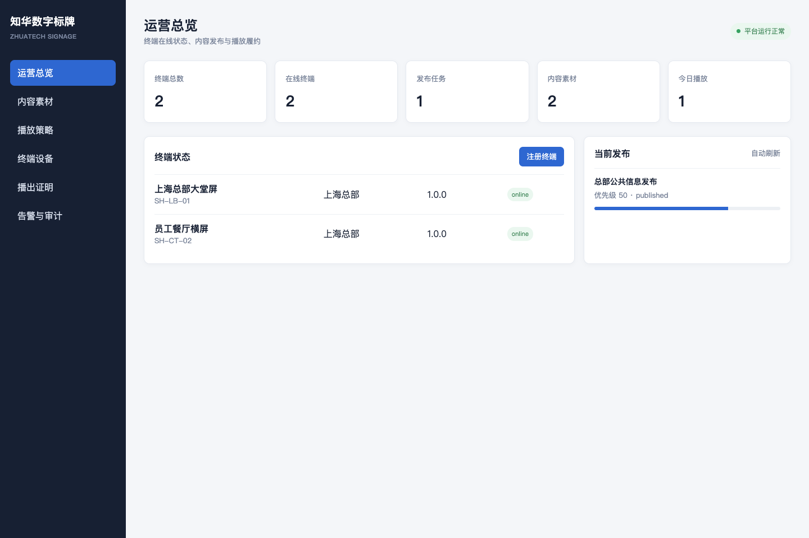
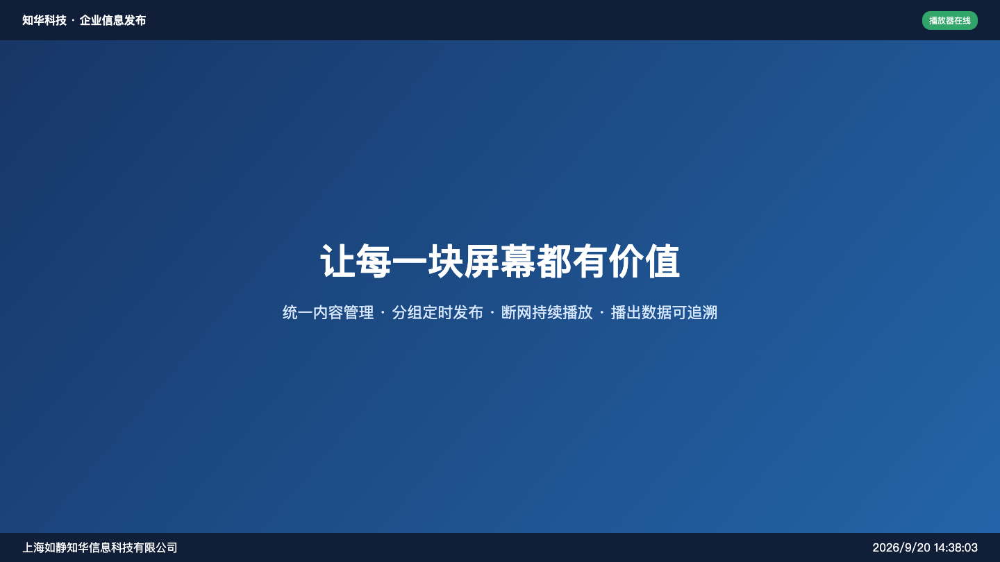

# 知华数字标牌与信息发布平台（ZhuaTech Signage）

面向企业园区、连锁门店、展厅、学校与公共空间的数字标牌社区源码版。项目不是只有一个后台页面：它实现了**内容登记 → 播放单编排 → 分组/定时发布 → 播放器拉取签名清单 → 断网缓存 → 播出证明回传**的业务闭环。

由[知华科技（上海如静知华信息科技有限公司）](https://www.zhuatech.cn/)维护。中小企业信息化、屏幕终端接入、商业授权或深度定制，请微信添加 `zhuatech` 或 `zhuatech2`。

| 运营管理端 | 屏幕播放器端 |
| --- | --- |
|  |  |

## 已实现能力

| 领域 | 可用功能 |
| --- | --- |
| 终端 | 唯一编号注册、设备令牌、标签/场所分组、心跳、播放器版本和存储监测 |
| 内容 | 图片/视频/HTML 素材元数据、SHA-256 校验、时长设置、就绪状态 |
| 编排 | 有序播放单、版本号、素材存在性校验 |
| 发布 | 终端/标签投放、起止时间、优先级、发布幂等、发布修订号 |
| 播放器 | 按终端生成签名清单、离线缓存协议、专用 TV 播放页面 |
| 履约 | 播出证明去重、播放时长记录、审计事件、运营驾驶舱 |
| 安全 | API Key、设备令牌入口、输入校验、无路径穿越的静态资源映射 |

## 快速运行

```bash
cp .env.example .env
npm test
SIGNAGE_API_KEY=zhuatech-demo-key npm start
```

打开 `http://127.0.0.1:18081/` 查看运营中心，打开 `/player` 查看 TV/广告屏播放器。API 调用需携带 `x-api-key`，演示值为 `zhuatech-demo-key`。

Docker：`docker compose up --build`。接口与部署边界见 [API](docs/API.md) 和 [架构说明](docs/ARCHITECTURE.md)。

## 项目结构

```text
src/domain.js       业务规则、幂等、签名清单与审计
src/server.js       零依赖 HTTP API、持久化与静态界面
public/console.html 运营管理端
public/player.html  屏幕播放器端
test/               Node 原生自动化测试
```

## 许可边界

本项目采用“知华科技社区源码许可协议（个人非商业版）”，**仅允许个人学习、研究和交流，不得商用**。企业内部生产、SaaS、交付、投标、收费服务及其他商业用途均须取得上海如静知华信息科技有限公司书面授权。该限制意味着本项目属于 source-available 社区源码，而非 OSI 定义的开源许可证项目。

Copyright © 上海如静知华信息科技有限公司。

## 微信咨询

| 微信号 `zhuatech` | 微信号 `zhuatech2` |
| --- | --- |
|  |  |
